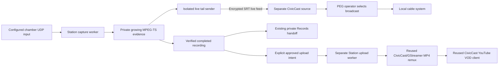

# Station delivery integrations — Townlight Beta 1, unpublished extension

This source extension adds only completed-recording YouTube uploads and a live
Station-to-CivicCast feed. It is **not in the published Beta 1 installer**. Existing
component versions are retained. New Station code is AGPL-3.0-only. The pinned
CivicCast source and third-party licenses remain unchanged. Standalone CivicCast
is a separate product; no installer, account, database, service or default in it
is changed by Station.

## Staff workflow

For live coverage, choose a meeting, its chamber input and the administrator's
**CivicCast live feed** option, then start recording. Choose **Recording only**
to capture privately without a network feed. A disconnected receiver does not
stop the recording. Station sends the live MPEG-TS bytes as the recording grows;
it does not wait for the completed file. The feed is available only during that
capture. The CivicCast/PEG operator selects that source and controls when it is
broadcast on local cable. Station does not automatically put the PEG channel on
air. `sending` means transport bytes were sent, not proof of cable carriage.

After Station shows **complete**, use **Upload completed recording to YouTube**.
Review the title, select private/unlisted/public visibility (default **private**),
and enter the approval note. Click **Upload to YouTube**. This is an explicit
external upload to the Station-configured OAuth account. No upload occurs just
because recording stopped, a playout was committed or a Records attachment was
made. Station does not create a YouTube livestream.

The upload receipt shows queued/running/uploaded/failed/needs-reconciliation,
the chosen visibility and returned video link. `uploaded` is the YouTube upload
acknowledgement; YouTube may still be processing the video. The canonical
recording remains private and byte-identical for the existing Records handoff.
The YouTube visibility is separate from local playback/disclosure approval.

## Architecture



The sender has bounded, leaky buffers and follows the live edge after congestion.
Its network sink shares no pipeline with the recorder. A late join or connection
loss can leave a live coverage gap, while the private recording continues.
H.264/AAC and existing MPEG-TS captions are forwarded without another encode.
The MP4 upload remux reuses `vod_job.py`; it does not generate transcripts or
captions, and does not upload a separate caption track. Upload queue work runs
in a separate process so a long upload never monopolizes the capture worker.

## Administrator setup

Use Station's existing dedicated data root and PostgreSQL database. Stop Station
writers for a coordinated backup, retain that backup, and run the explicit
`townlight-station migrate` before starting this source version. Schema **4** adds
`station.youtube_uploads`, keeping existing recording/schedule/playout evidence.
The data identity marker and component versions are unchanged. Old services
expect schema 3; use a matched source/runtime and preserve the backup for rollback.

Create `civiccast-feeds.json` in the private Station data directory:

```json
[
  {
    "id": "peg",
    "label": "CivicCast council feed",
    "address": "192.0.2.10",
    "port": 10080,
    "secret_env": "TOWNLIGHT_STATION_SRT_PEG"
  }
]
```

The address is a numeric IPv4 **local interface bind address on Station**, not the
CivicCast computer. `192.0.2.10` is a documentation placeholder. Use the actual
Station interface, an unused port (1024–65535), and appropriate network access
between those two systems. Clients select an administrator-defined ID, never an
arbitrary destination or media pipeline. Keep configuration files private.

Set `TOWNLIGHT_STATION_SRT_PEG` in the capture worker's process environment to a
10–79 character SRT passphrase. Configure a separate CivicCast SRT live source
with the caller URI `srt://<Station-address>:10080?mode=caller&latency=200` and the
same passphrase through CivicCast's existing credential control. Do **not** put
the passphrase in the URI. Station's listener uses 128-bit SRT encryption.
Keep the two accounts and configuration stores separate; matching this specific
transport credential is the deliberate pairing. Site-specific camera, headend
and firewall commissioning remain deployment work.

For completed uploads, configure these **Station-only** environment variables in
the upload worker process. Obtain OAuth authorization for the intended Station
YouTube channel/account through the existing deployment's Google configuration;
no OAuth onboarding framework is added here. Do not use CivicCast's credentials
implicitly or copy its profile.

- `TOWNLIGHT_STATION_YOUTUBE_CLIENT_ID`
- `TOWNLIGHT_STATION_YOUTUBE_CLIENT_SECRET`
- `TOWNLIGHT_STATION_YOUTUBE_REFRESH_TOKEN` (authorized for YouTube video uploads)

Run the existing `serve` and capture `worker`, plus the separate upload consumer
with the same Station settings and dedicated database:

```powershell
townlight-station migrate
townlight-station serve
# In separate managed processes with the same explicit Station configuration:
townlight-station worker
townlight-station uploads
```

These are deployment commands, **not commands executed against installed apps
by this development task**. Run only one capture worker and one upload worker per
database. Each holds a distinct advisory lock; media children require the existing
Windows job containment. The recorder child gets no provider credentials; the
SRT child receives only its explicit transport passphrase plus the existing
runtime allowlist. The upload worker reads only the Station OAuth variables.
OAuth/upload HTTP is restricted to Google HTTPS hosts; redirects are not followed.
The pinned donor import is checked against Station's declared media source.

## HTTP API and examples

All `/v1` operations below require the existing current Townlight staff session
header (`X-Townlight-Session`) or the existing same-origin operator session. Read
roles can inspect receipts. Starting live feed/upload/retry requires the existing
Station `capture` capability. No new login, role system or MCP server is added.

| Method and route | Purpose |
| --- | --- |
| GET `/v1/civiccast-feeds` | Capture-authorized list of configured IDs and labels; no transport credentials |
| POST `/v1/recordings` | Existing capture contract plus optional `civiccast_feed_id`, allowed only with `live_source_id` |
| POST `/v1/recordings/{recording_id}/youtube` | Queue one explicit completed-recording upload |
| GET `/v1/youtube-uploads` | Read-authorized latest 100 durable upload receipts |
| POST `/v1/youtube-uploads/{upload_id}/retry` | Capture-authorized retry of a **preparation** failure only |

Station's generated `/openapi.json` includes the new routes and request schemas.
Example bodies (use real canonical IDs from the selected deployment):

```json
{
  "meeting_id": "11111111-1111-4111-8111-111111111111",
  "agenda_ids": [],
  "live_source_id": "chamber",
  "civiccast_feed_id": "peg",
  "idempotency_key": "council-live-2026-10-30"
}
```

```json
{
  "title": "City council meeting — 30 October 2026",
  "privacy": "private",
  "approval_note": "Reviewed completed recording for upload",
  "idempotency_key": "council-vod-2026-10-30"
}
```

Upload titles are 1–100 characters; control characters and angle brackets are
rejected. Visibility is private/unlisted/public; approval note 3–500 characters;
key 1–100 characters. Repeating the same key returns the same intent, a changed
request conflicts, and another key cannot duplicate an existing recording upload.
A missing/uncompleted/tampered recording is rejected before upload admission;
the worker independently verifies the recording hash before remuxing/sending.
Retained receipts include approving actor, note/time, recording hash, MP4 path/
hash/size, chosen title/privacy and provider video ID/URL after acknowledgement.
No OAuth token, passphrase or donor credential pointer is stored in receipts.

## Recovery and limits

A failed preparation (for example missing Station OAuth configuration or failed
remux) is `failed`; correct the cause and explicitly call its retry route. The
prior attempt files remain retained. Once any external request begins, an error
is conservatively `needs-reconciliation`. A worker restart also moves interrupted
`running` uploads to that state. There is no automatic retry that could create a
duplicate YouTube video. Check YouTube Studio and the retained job before a human
chooses another external action. This increment provides no automatic remote
reconciliation/delete/reupload control. A valid uploaded link is retained even
if the capture worker is restarted. The existing recording/Records path does
not depend on the external upload succeeding.

Live sender state is in the recording's `details.civiccast_delivery`; its final
byte count and per-attempt status/log files stay with the private recording.
On capture-worker restart, an interrupted feed is marked interrupted rather
than left appearing to send. Stop/reap is bounded even if the network child hangs.
No feed is automatically re-aired after recovery.

## Verification and release status

`tests/accept_deliveries.py` exercises the real Station API/store/media/remux,
CivicCast's pinned SRT source adapter and real YouTube file-upload client using a
disposable PostgreSQL cluster, generated audio/video, synthetic staff authority
and `httpx.MockTransport` for Google. No city systems or external publication
are involved. `tests/accept_delivery_ui.cjs` drives the actual compiled operator
controls in headless Chromium with synthetic API responses. Existing boundary/
operations checks and TypeScript compilation also apply.

Example invocation from a development environment with existing dependencies:

```powershell
$env:PYTHONPATH = (Resolve-Path ./beta-1).Path
$env:STATION_TEST_PG_BIN = 'C:/test-tools/postgres/bin'
$env:STATION_TEST_MEDIA_RUNTIME = 'C:/test-tools/station-media-runtime'
python -B ./beta-1/tests/accept_deliveries.py C:/test-output/station-deliveries-new
```

Use a **new** output directory; the script starts/stops only its owned disposable
cluster and children. See the task's retained acceptance receipts for actual
results. This evidence establishes the new source wiring synthetically. It does
not replace CivicCast's already established real YouTube delivery evidence, nor
claim a new real YouTube upload, physical cable broadcast, signed installer or
Sandbox acceptance of this extension. Published Beta 1 artifacts stay unchanged.
