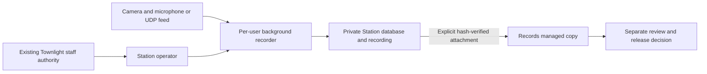

# Windows recorder completion contract

## Windows recorder update — 1.9.0.1 candidate (not published)

This section describes the new candidate. The public 1.8.2.1 MSI does not acquire these capabilities until a new release is approved and published. Installed acceptance of this candidate is still pending.

### Clerk and operator

1. Install Townlight and complete normal first-run setup with the full Windows profile or a custom selection that includes Meetings and Records (Station is bundled). Finishing setup provisions the bundled recorder, a private database and Windows sign-in task. No PostgreSQL, Python or media-runtime installation commands are needed. Existing installations use Settings → Modules → Townlight Station → **Set up meeting recording**.
2. Keep Windows signed in and the computer awake while recording. The recorder runs in that user's device-access session, independently of the Townlight window. It is not a multi-user server or a full PEG station. Closing the recorder tab does not stop a recording.
3. Sign in with an existing authorized staff account. From Meetings choose **Open / reconnect to meeting recorder**. Select a meeting and its agenda items. In input setup, find devices, choose one camera/capture device and one microphone, and save. Record a ten-second input test, then play it to check the picture and sound; the meter responds during playback. This test clip is temporary and is not a canonical meeting record. Windows camera/microphone privacy settings and exclusive device use still apply. Configured UDP MPEG-TS input remains supported.
4. Start the meeting recording. The default duration limit is eight hours, with a 64 GiB file limit and at least 1 GiB reserved disk space. Admission estimates the configured duration and bitrate. Free space is monitored while recording; low space or a limit requests a graceful stop and displays the reason. These are configured limits, not a claim that every eight-hour meeting has been tested. Plan space for the recording, its Records copy and backups. Sleep, sign-out, power failure and unavailable hardware can interrupt capture.
5. An open operator page renews its fifteen-minute session against the current Townlight staff authority. Sign-out, revoked permissions and the underlying staff-session expiry still take effect. Reopen from Townlight to reconnect to an existing recording; reconnect never starts a second recording. Select **Stop recording** to drain and finalize the file.
6. After completion, an authorized Records user selects a request and explicitly attaches the recording. Records streams a separate managed copy and verifies SHA-256, size and provenance; files up to 64 GiB are accepted subject to available space. Attachment is not public release. Review, redaction and publication remain separate Records decisions.

### Administrator and recovery

Station setup uses bundled native dependencies and its existing pinned CivicCast media implementation; it never starts or changes CivicCast or CivicCast Lab. The per-user logon task owns a separate PostgreSQL instance on loopback port 15435; Station's API listens only on 127.0.0.1:8756. Townlight's existing staff authority remains on its configured Suite origin. Protected settings and database credentials remain in the recorder data directory, under the selected city data location. Setup refuses unrelated nonempty storage or an unrelated task with the same name. Retry setup after correcting readiness errors; inspect the private background, PostgreSQL, API and worker logs when needed.

Use **Check recorder readiness**, **Back up Station**, and **Restore Station backup** in Settings → Modules. Finish queued and active recordings before backup or restore. Backups contain a PostgreSQL dump, recording/ingest files, saved source choices and a SHA-256 member manifest; they omit credentials and native executables. Restore verifies the members, creates a pre-restore recovery copy, and restores into this installation's separately protected database. Recheck input selection afterward. A Suite backup includes a coherent Station backup when paired; it does not copy the running Station database or its secrets. Suite restore preserves that live private directory and applies the included Station backup separately.

