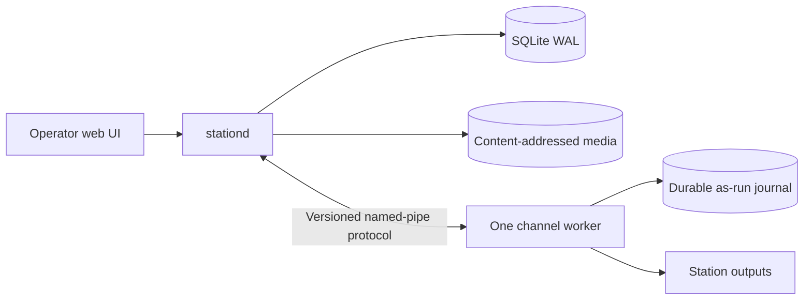

# Architecture overview

TownLight Station is a Windows appliance with local authority. Internet services may extend it, but loss of the Internet cannot take a commissioned channel off air or destroy its operating record.

## Runtime boundaries



`stationd` is a modular monolith and the only writer to the authoritative station database. A separate persistent worker owns each channel's GStreamer graph, media clock, output switching, and append-only as-run journal. File processing and optional local AI run outside both timing-critical and authoritative paths.

On an installed station, Windows Service Control Manager owns the `stationd` process. Service startup requires an absolute database path and a loopback HTTP address. The process reports start-pending, running, stop-pending, and stopped states; both an operator stop and operating-system shutdown drain through the same cooperative API stop signal. See [ADR 0005](../adr/0005-native-windows-service.md).

One elevated setup executable carries the station binaries and a private, hash-pinned media runtime. Activation precedes formal product registration and must reach SCM running state plus HTTP/database readiness; otherwise staged resources are rolled back and setup returns nonzero. Uninstall removes executable state but preserves the authoritative station database. See [ADR 0006](../adr/0006-health-gated-windows-installer.md).

The initial control-plane dependency direction is enforced by the Cargo workspace:

```text
station-domain <- station-storage <- station-api <- stationd
station-media-lifecycle <- station-storage <- station-ingest <- stationd
station-update <- station-storage <- station-update-coordinator <- station-api <- stationd
```

The domain crate has no storage, HTTP, media, or Windows-service dependencies. Storage translates domain objects to SQLite. The API owns transport and error contracts. The daemon is composition and process lifecycle only.

`station-media-protocol` is independent of the control-plane crates. It defines bounded length-prefixed command and event envelopes, explicit protocol versions, command identifiers, expected worker sequences, and durable event sequences. See [ADR 0001](../adr/0001-media-worker-protocol.md).

`station-media-journal` owns the append-only per-channel record. `channel-worker` is its sole writer. Every record has a journal magic/version header, bounded length, CRC-32 checksum, worker/channel identity, and strict monotonic event sequence. Writes are flushed and synchronized before the corresponding event is emitted. Restart scans the complete journal and resumes at the next sequence; corruption and partial tails prevent a false clean recovery. See [ADR 0002](../adr/0002-durable-channel-journal.md).

`station-windows-ipc` owns the local control boundary. Each worker connects to one duplex byte-mode named pipe beneath `\\.\pipe\townlight-station\`. Pipe creation rejects duplicate servers and remote clients, and applies a protected ACL limited to SYSTEM, Administrators, and the creating user. Commands and events use the same versioned frames; standard input and output are not protocol transports.

`station-runtime` owns worker process lifecycle from the station side. It creates the exclusive pipe, launches the worker without inherited protocol handles, and sends the complete typed output bootstrap through that protected pipe rather than exposing destinations or SRT credentials in process arguments. Passphrases arrive from machine-protected storage and use a debug-redacted protocol type. The supervisor bounds connection and response waits, accepts only the configured worker/channel identity and next sequence, requires a durable `Ready` handshake, and terminates and reaps the child on every failed launch, timeout, or abandoned session. Clean shutdown is complete only after `ShutdownComplete` and a successful process exit. See [ADR 0003](../adr/0003-supervised-worker-lifecycle.md), [ADR 0024](../adr/0024-protected-worker-bootstrap.md), and [ADR 0026](../adr/0026-machine-protected-srt-passphrases.md).

The orchestration loop also owns runtime observability. It polls worker process liveness independently of schedule traffic and stores one monotonic five-second heartbeat per enabled channel only after a real protected-pipe round trip reports strictly advancing local byte counters for every required output. `healthy_fallback` is explicit green operating truth; stale heartbeats, process loss, invalid execution state, pipeline errors, or stalled required branches fail red. Process/control failures create durable `encoder-death` plus `off-air` incidents; pipeline/progress failures create `output-stall` plus `off-air`. Repeated samples increment the existing event, successful restart resolves the applicable incidents, and restarts are paced at 1/5/15/60 seconds. The operator API derives the station's safe-to-air color from enabled-channel runtime plus firing alerts. See [ADR 0014](../adr/0014-runtime-health-and-incident-authority.md) and [ADR 0027](../adr/0027-required-output-progress-heartbeats.md).

Operator alert destinations attach to that incident boundary without entering channel supervision. Public rows contain only kind, label, enabled/quiet-hours policy, a redacted target, and credential-presence state. The target plus provider configuration and credential are serialized together, protected by Windows DPAPI with machine scope and UI disabled, and stored only as an opaque SQLite BLOB. A condition-specific rule owns enabled state, severity, output scope, destination selection, resolve notification, and the bounded re-alert interval. First failure and resolution atomically create immutable delivery payload snapshots; repeat samples only increment the firing event until a selected destination's re-alert window elapses. Each paced re-alert is a distinct durable record. A separate service thread leases due jobs, recovers abandoned leases, dispatches authenticated SMTP, authenticated SMS-provider HTTPS, or signed webhook HTTPS, and records sent/retry/dead-letter truth. Critical delivery ignores quiet hours; warning/info waits until the UTC window closes. Operator send-test uses that same queue and ledger, but records a resolved informational audit event so a configuration check cannot create false unhealthy state. See [ADR 0015](../adr/0015-encrypted-alert-destinations.md), [ADR 0016](../adr/0016-durable-operator-alert-delivery.md), and [ADR 0017](../adr/0017-rule-owned-alert-policy-and-realerting.md).

`station-media-assets` owns the admission boundary for file bytes. It discovers real stream metadata, requires finite A/V, atomically copies and synchronizes the source into a SHA-256-addressed library object, revalidates the stored copy, and treats duplicate content as the same asset. See [ADR 0007](../adr/0007-content-addressed-media-ingest.md).

`station-media-lifecycle` owns durable ingest and transcode job state without depending on GStreamer or SQLite. The API persists an operator-path request as `pending` and returns immediately. `station-ingest` first validates and stores source bytes, then atomically changes the parent to `awaiting_transcode` while creating its deterministic child job. A separate claim executes the canonical transform. Only the verified, independently hashed derivative is published as `ready`, in the same transaction that completes both jobs and records passing post-transcode loudness. Interrupted running work is safely requeued; transient failures use bounded durable backoff. See [ADR 0010](../adr/0010-durable-background-media-ingest.md) and [ADR 0013](../adr/0013-durable-canonical-transcode.md).

The same lifecycle boundary owns unattended watch-folder intent and scan health. A five-second monitor reads enabled local, USB, or SMB/NAS folders without treating temporary unavailability as a daemon failure. SQLite observations require nonzero files with identical size and modification time across at least two polls and the configured settle duration. A deterministic UUID derived from folder, path, size, and modification time makes queueing idempotent across crashes. A changed file version resets the observation and becomes new work. Transient source I/O failures return to `pending` with durable bounded backoff; unsupported media fails visibly. See [ADR 0011](../adr/0011-resilient-watch-folder-ingest.md).

Canonical transcode runs a bounded EBU R128 analysis against the derivative bytes. The result is stored in integer milli-LUFS with a -24 LUFS ±2 LU target, so database authority is deterministic and transport JSON can still expose human-scale LUFS. A derivative can become `ready` only with passing post-transcode loudness. An analyzer or normalization failure remains visible job failure, never invented success. See [ADR 0012](../adr/0012-ingest-time-loudness-gate.md) and [ADR 0013](../adr/0013-durable-canonical-transcode.md).

The operator console is a production React/TypeScript bundle embedded into `stationd` and served from the same loopback origin as the API. It commissions station identity and provides responsive views for readiness, media/job state, channels, schedule commit, dispatch, and commissioning. It carries no runtime dependency on an Internet service, CDN, or separate web server.

`station-schedule` owns schedule and commit-to-air rules independently of HTTP, SQLite, and the media worker. `station-storage` persists channels, assets, schedule items, and approval reports. Preview is informative; approval starts a SQLite immediate transaction and reruns the complete gate so an overlap or media-state change that appeared after preview cannot race onto air. `station-orchestration` owns the state bridge from durable approval to worker execution: load acknowledgment produces `queued`, the scheduled take acknowledgment produces `acknowledged`, and fallback return after the scheduled end produces `completed`. Compare-and-set updates prevent competing controllers from claiming the same transition. See [ADR 0008](../adr/0008-commit-to-air-authority.md) and [ADR 0009](../adr/0009-acknowledged-schedule-dispatch.md).

`station-media-engine` owns the GStreamer graph. It builds all elements through factories and leaves OpenH264, AAC, the parsers, `mpegtsmux`, and stable output branches in one persistent graph across switches. A validated stored asset can be decoded and added while fallback remains on air. Preparing the next asset uses generation-scoped elements; only after the new leg is ready does it become the program target, after which the retired decoder is disconnected, stopped, awaited in `NULL`, and removed. File pads receive the running pipeline offset, both selectors feed single continuous timelines, and video/audio rate adjusters prevent boundary jitter. A typed output profile crosses UI, API, SQLite, supervision, process, and GStreamer boundaries without reinterpretation. After the one encoder and mux, a tee feeds isolated queues and typed UDP-TS or SRT caller sinks; channel configuration persists stable sink identities separately from the encoded profile. Required SRT branches must connect and transmit before worker readiness; encrypted branches set a write-only passphrase with a 32-byte AES key. The Windows machine tests validate actual transport across two distinct real assets, prove 720p59.94 dimensions, cadence, and CBR rate, receive the same live transport on two independent UDP destinations, and capture both open and AES-256 MPEG-TS through real SRT caller/listener pairs. See [ADR 0004](../adr/0004-persistent-gstreamer-graph.md), [ADR 0022](../adr/0022-typed-output-profile-contracts.md), [ADR 0023](../adr/0023-stable-output-branches.md), [ADR 0025](../adr/0025-required-srt-caller-output.md), and [ADR 0026](../adr/0026-machine-protected-srt-passphrases.md).

The first CG renderer slice is now bounded behind the same worker protocol. A continuously flowing
black canvas feeds eight logical serial text/clock overlay pairs followed by black-key transparency;
UDP branches install this fixed topology before PLAYING, while SRT branches attach it after required
output readiness. Live updates change properties rather than graph topology. The cache-only
resolved snapshot is handed to the worker with `ApplyCgSnapshot`/`ClearCgSnapshot`; complete
snapshot equality controls deduplication, and invalid updates retain the last valid visible state.
The implemented scope is manual/bulletin text, clock, and static lower-third, ticker-region, and
bug-region geometry. Feed normalization has offline hostile-input coverage, and the focused decoded
UDP pixel apply/change/clear gate passes. The service also runs bounded direct-HTTPS feed fetching;
the channel orchestration cadence atomically expires due scheduled bulletins before resolving the
same timestamp's snapshot. External-provider compatibility, installed operation, and field soak
remain separate gates. See [ADR 0030](../adr/0030-fixed-cg-overlay-compositor.md), [hostile feed proof](../proof/2026-08-21-feed-hostile-normalization.md), [feed lifecycle proof](../proof/2026-08-21-cg-feed-fetch-lifecycle.md), [bulletin expiration proof](../proof/2026-08-21-cg-bulletin-expiration.md), and [decoded CG proof record](../proof/2026-08-21-cg-udp-decoded-pixel.md).

## Authority rules

| Truth | Owner |
|---|---|
| Configuration, assets, schedules, approvals, jobs | `stationd` through SQLite |
| Media bytes | Content-addressed NTFS store |
| Current on-air execution | Channel worker |
| What actually aired | Durable per-channel journal |
| Runtime health, incidents, redacted destinations, and delivery truth | SQLite heartbeat, alert, DPAPI-protected destination, and leased delivery records |
| Installed version | Signed candidate and installation receipts |

## Product languages

Rust is used for native services, workers, command-line tools, and installation infrastructure. TypeScript and React are used for browser interfaces. Apple, Android, Roku, and web resident clients use their platform-native production toolchains.

## Non-negotiable decisions

- One canonical repository produces one candidate identity.
- SQLite WAL is the local authority; no database server is installed.
- Every channel has one persistent GStreamer production engine.
- FFmpeg may perform bounded file work but never linear playout.
- Media workers cannot write the station database.
- On-air events are journaled durably before they are acknowledged.
- Configuration is typed and audited; environment variables are development bootstrap only.
- Updates use signed immutable slots, health deadlines, and rollback.
- A capability is not complete until its installed-machine scenario passes.

## Current vertical slice

The current spine installs from one setup executable, runs under Windows Service Control Manager, serves its responsive operator console, commissions a station profile, persists channel/runtime/alert-destination/delivery/media/job/schedule/approval authority transactionally in SQLite with WAL and foreign-key enforcement, and exposes database readiness through `GET /health`. The loopback system can configure a channel output, report runtime safe-to-air state, acknowledge durable incidents, store redacted encrypted operator alert destinations, durably deliver first-failure and resolution notifications, admit source media, produce and publish a verified canonical derivative, create a draft schedule item, preview the commit gate, atomically approve it, list the channel schedule, and retrieve the approval report. The daemon supervises each enabled channel, dispatches committed work against wall-clock start and end times, and independently drains the operator-alert delivery queue.

The alerting subsystem also owns a one-minute Windows host sampler. CPU, RAM, station-volume free space, backup-volume free space, and a real backup write/read/delete result are retained for seven days and exposed as latest operating truth. Low or unwritable storage enters the same rule-owned durable incident path. See [ADR 0018](../adr/0018-service-owned-system-resource-sampling.md).

It also owns unattended daily and weekly self-tests. SQLite seeds operator-editable 02:00 daily and Sunday 03:00 weekly schedules; due evaluation converts UTC through the commissioned station's IANA timezone and uses a unique local-period key to survive restart and repeated scheduler ticks without duplicate runs. Each result persists named check truth, pass/warn/fail classification, and an atomically published evidence file. Core failures route through the normal rule-owned alert lifecycle. Weekly validation adds a real SQLite backup/restore/integrity rehearsal and queues tests for every enabled operator-alert destination. See [ADR 0019](../adr/0019-durable-station-self-tests.md).

Support export is a separate typed service boundary rather than a database copy or directory grab. It reads only explicitly selected public operational records, converts alert deliveries/events and self-tests into reduced redacted shapes, and packages bounded JSON windows into an atomically published ZIP. The manifest records every entry's byte length and SHA-256; the API returns the archive's outer SHA-256 and a validated same-origin download route. The station database, secrets, payloads, signatures, raw errors/logs, raw environment, full media paths, and subscriber data never enter the exporter. See [ADR 0020](../adr/0020-redacted-manifested-support-bundles.md).

Update discovery is data, never executable authority. `station-update` verifies a bounded release envelope with an installer-owned Ed25519 trust set and strict signature checks, then validates product/channel identity, semantic version, source commit, freshness and expiry, minimum updater version, HTTPS package location, exact size/hash, and bounded release notes. Checks may run hourly and never download a package. A separate explicit operator action streams only the current verified offer through a zero-redirect platform-verified client, signed byte ceiling, exact length, and SHA-256 into a content-addressed read-only stage; failures delete quarantine bytes and cannot create staged database truth. Another explicit action validates the strict internal package manifest and exact role-fixed payload set, then atomically publishes a read-only `slot-<version>-<commit>` directory without touching the running installation. An installer-owned out-of-process updater records the prior receipt, stops the service, activates the candidate, and performs bounded health plus green safe-to-air proof. Failed candidate proof restores and proves the exact prior slot; all phases remain visible in the maintenance ledger and support bundle. See [ADR 0021](../adr/0021-signed-immutable-update-lifecycle.md).

The first channel worker now runs as an independent supervised process and owns its persistent GStreamer graph. Durable `Ready` follows successful fallback output startup; durable `AssetLoaded` follows identity verification and dynamic decode readiness; durable `OnAirChanged` follows an acknowledged asset or fallback transition; durable `ShutdownComplete` follows graph shutdown. Machine proofs drive two distinct ingested files on air in sequence and drive a committed timed item across restarts before and after take, proving that persisted dispatch state is reconciled to actual worker state. Installed-candidate proofs have completed source admission, canonical transcode, readiness, approval, dispatch, take, fallback return, and post-run health. One progressive HD IP output profile, redundant UDP-TS fanout, unencrypted required SRT caller output, and machine-protected AES-256 SRT are installed-machine-proven. Live inputs, interlaced formats, SDI/NDI, remote SRT interoperability, and the multi-week field gates remain later gates.
