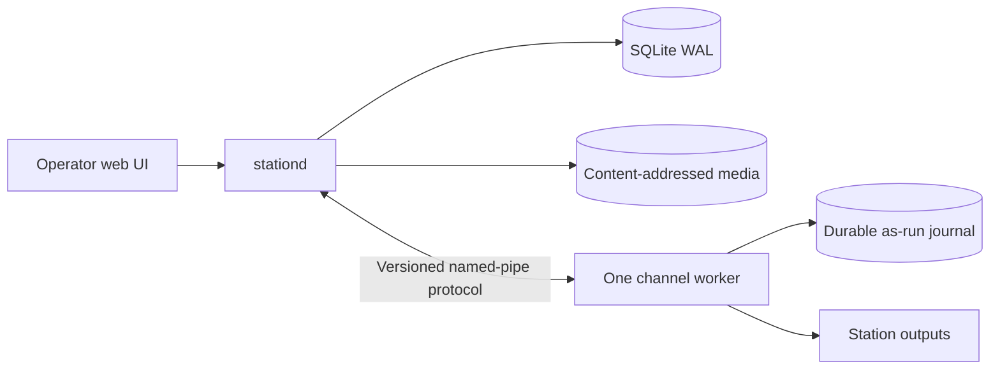

# Architecture overview

TownLight Station is a Windows appliance with local authority. Internet services may extend it, but loss of the Internet cannot take a commissioned channel off air or destroy its operating record.

## Runtime boundaries



`stationd` is a modular monolith and the only writer to the authoritative station database. A separate persistent worker owns each channel's GStreamer graph, media clock, output switching, and logically append-only as-run journal. File processing runs outside both timing-critical and authoritative paths. Future optional local AI will use the same sidecar boundary; no AI runtime or selection capability is implemented yet.

On an installed station, Windows Service Control Manager owns the `stationd` process. Service startup requires an absolute database path and a loopback HTTP address. The process reports start-pending, running, stop-pending, and stopped states; both an operator stop and operating-system shutdown drain through the same cooperative API stop signal. See [ADR 0005](../adr/0005-native-windows-service.md).

One elevated setup executable carries the station binaries and a private, hash-pinned media runtime. It freshly replaces that runtime, creates a bounded full-file manifest before service start, and binds the exact manifest digest into the protected installation receipt. Activation precedes formal product registration and must reach SCM running state plus HTTP/database readiness; otherwise staged resources are rolled back and setup returns nonzero. Uninstall removes executable state but preserves the authoritative station database. See [ADR 0006](../adr/0006-health-gated-windows-installer.md) and [ADR 0044](../adr/0044-authenticated-installed-runtime-manifest.md).

The initial control-plane dependency direction is enforced by the Cargo workspace:

```text
station-domain <- station-storage <- station-api <- stationd
station-captions <- station-storage <- station-api <- stationd
station-media-lifecycle <- station-storage <- station-ingest <- stationd
station-update <- station-storage <- station-update-coordinator <- station-api <- stationd
```

The domain crate has no storage, HTTP, media, or Windows-service dependencies. Storage translates domain objects to SQLite. The API owns transport and error contracts. The daemon is composition and process lifecycle only.

`station-media-protocol` is independent of the control-plane crates. It defines bounded length-prefixed command and event envelopes, explicit protocol versions, command identifiers, expected worker sequences, and durable event sequences. See [ADR 0001](../adr/0001-media-worker-protocol.md).

`station-media-journal` owns the logically append-only per-channel record. `channel-worker` is its sole writer. Every physical record has a journal magic/version header, bounded length, and CRC-32 checksum; logical history has one worker/channel identity and complete sequence coverage. Writes are flushed and synchronized before the corresponding event is emitted. Format v2 retains every non-heartbeat event and recent heartbeat samples verbatim, then summarizes older heartbeat runs in bounded records with sequence/timing/counter endpoints and a SHA-256 digest chain. A synchronized commit record closes each temporary compaction before atomic replacement, and the typed inspection view exposes retained and summarized evidence. Restart validates the journal and resumes at the next covered sequence; corruption, uncovered gaps, wrong identity, incomplete temp artifacts, and replacement ambiguity prevent a false clean recovery. See [ADR 0002](../adr/0002-durable-channel-journal.md).

`station-windows-ipc` owns the local control boundary. Each worker connects to one duplex byte-mode named pipe beneath `\\.\pipe\townlight-station\`. Pipe creation rejects duplicate servers and remote clients, and applies a protected ACL limited to SYSTEM, Administrators, and the creating user. Commands and events use the same versioned frames; standard input and output are not protocol transports.

`station-runtime` owns worker process lifecycle from the station side. It creates the exclusive pipe, launches the worker without inherited protocol handles, and sends the complete typed output bootstrap through that protected pipe rather than exposing destinations or SRT credentials in process arguments. Passphrases arrive from machine-protected storage and use a debug-redacted protocol type. The supervisor bounds connection and response waits, accepts only the configured worker/channel identity and next sequence, requires a durable `Ready` handshake, and terminates and reaps the child on every failed launch, timeout, or abandoned session. Product orchestration allows at least 30 seconds for process and real media-graph bootstrap under load while retaining shorter steady-state command deadlines. Clean shutdown is complete only after `ShutdownComplete` and a successful process exit. See [ADR 0003](../adr/0003-supervised-worker-lifecycle.md), [ADR 0024](../adr/0024-protected-worker-bootstrap.md), and [ADR 0026](../adr/0026-machine-protected-srt-passphrases.md).

The orchestration loop also owns runtime observability. It polls worker process liveness independently of schedule traffic and stores one monotonic five-second heartbeat per enabled channel only after a real protected-pipe round trip reports strictly advancing local byte counters for every required output. `healthy_fallback` is explicit green operating truth; stale heartbeats, process loss, invalid execution state, pipeline errors, or stalled required branches fail red. Process/control failures create durable `encoder-death` plus `off-air` incidents; pipeline/progress failures create `output-stall` plus `off-air`. Repeated samples increment the existing event, successful restart resolves the applicable incidents, and restarts are paced at 1/5/15/60 seconds. The operator API derives the station's safe-to-air color from enabled-channel runtime plus firing alerts. See [ADR 0014](../adr/0014-runtime-health-and-incident-authority.md) and [ADR 0027](../adr/0027-required-output-progress-heartbeats.md).

Operator alert destinations attach to that incident boundary without entering channel supervision. Public rows contain only kind, label, enabled/quiet-hours policy, a redacted target, and credential-presence state. The target plus provider configuration and credential are serialized together, protected by Windows DPAPI with machine scope and UI disabled, and stored only as an opaque SQLite BLOB. A condition-specific rule owns enabled state, severity, output scope, destination selection, resolve notification, and the bounded re-alert interval. First failure and resolution atomically create immutable delivery payload snapshots; repeat samples only increment the firing event until a selected destination's re-alert window elapses. Each paced re-alert is a distinct durable record. A separate service thread leases due jobs, recovers abandoned leases, dispatches authenticated SMTP, authenticated SMS-provider HTTPS, or signed webhook HTTPS, and records sent/retry/dead-letter truth. Critical delivery ignores quiet hours; warning/info waits until the UTC window closes. Operator send-test uses that same queue and ledger, but records a resolved informational audit event so a configuration check cannot create false unhealthy state. See [ADR 0015](../adr/0015-encrypted-alert-destinations.md), [ADR 0016](../adr/0016-durable-operator-alert-delivery.md), and [ADR 0017](../adr/0017-rule-owned-alert-policy-and-realerting.md).

`station-media-assets` owns the admission boundary for file bytes. It discovers real stream metadata, requires finite A/V, atomically copies and synchronizes the source into a SHA-256-addressed library object, revalidates the stored copy, and treats duplicate content as the same asset. See [ADR 0007](../adr/0007-content-addressed-media-ingest.md).

`station-media-lifecycle` owns durable ingest and transcode job state without depending on GStreamer or SQLite. The API persists an operator-path request as `pending` and returns immediately. `station-ingest` first validates and stores source bytes, then atomically changes the parent to `awaiting_transcode` while creating its deterministic child job. A separate claim executes the canonical transform. Only the verified, independently hashed derivative is published as `ready`, in the same transaction that completes both jobs and records passing post-transcode loudness. Interrupted running work is safely requeued; transient failures use bounded durable backoff. See [ADR 0010](../adr/0010-durable-background-media-ingest.md) and [ADR 0013](../adr/0013-durable-canonical-transcode.md).

The same lifecycle boundary owns unattended watch-folder intent and scan health. A five-second monitor reads enabled local, USB, or SMB/NAS folders without treating temporary unavailability as a daemon failure. SQLite observations require nonzero files with identical size and modification time across at least two polls and the configured settle duration. A deterministic UUID derived from folder, path, size, and modification time makes queueing idempotent across crashes. A changed file version resets the observation and becomes new work. Transient source I/O failures return to `pending` with durable bounded backoff; unsupported media fails visibly. See [ADR 0011](../adr/0011-resilient-watch-folder-ingest.md).

Canonical transcode runs a bounded EBU R128 analysis against the derivative bytes. The result is stored in integer milli-LUFS with a -24 LUFS ±2 LU target, so database authority is deterministic and transport JSON can still expose human-scale LUFS. A derivative can become `ready` only with passing post-transcode loudness. An analyzer or normalization failure remains visible job failure, never invented success. See [ADR 0012](../adr/0012-ingest-time-loudness-gate.md) and [ADR 0013](../adr/0013-durable-canonical-transcode.md).

`station-captions` owns transport-independent caption-track identity, bounded asset-relative cue
validation, source provenance, and deterministic cue-set hashing. `station-storage` is the sole
writer: one authoritative track occupies each exact media-hash/language/CEA-service slot, and every
accepted compare-and-swap change stores both the current cues and a complete append-only revision
snapshot. A track identity cannot move to different media or a different language/service slot;
non-ready assets and assets currently on air reject mutation. This is caption source authority, not
proof of emission. Schedule-relative dispatch is server-owned, and a separate immutable egress-proof
contract can record only candidate/configuration/policy/track-bound transport capture plus
independent decode-back facts. Authenticated API requests provide only bounded proof intent; the
server requires a fresh exact on-air schedule/runtime binding, selects a future cue-bearing window,
derives every evidence identity, and exposes channel-confined leased status and immutable history.
Orchestration serializes caption work against loudness use of the worker's one final-sink proof tap,
renews the lease while waiting/capturing/analyzing, starts only inside the bounded asset-relative
window, verifies and atomically promotes the exact managed transport, and invokes the private
absolute decoder off the control loop. It rechecks candidate and configuration authority before the
atomic terminal proof write. Operational failures remain durable failed jobs; semantic inequality is
an immutable mismatch proof. Installed evidence and live ASR remain separate boundaries. See
[ADR 0050](../adr/0050-asset-bound-caption-track-authority.md),
[ADR 0051](../adr/0051-schedule-authoritative-caption-dispatch.md), and
[ADR 0052](../adr/0052-caption-egress-proof-authority.md).

The operator console is a production React/TypeScript bundle embedded into `stationd` and served from the same loopback origin as the API. It commissions station identity and provides responsive views for readiness, media/job state, channels, schedule commit, dispatch, and guided commissioning. Commissioning report schema v2 owns the ordered current step, required progress, and `core_complete` on the server. Its full local checklist covers identity/auth, StationBox/storage/time/backup, watch-folder and channel/output policy, named headend and cable analysis, a causally linked real ingest → commit → worker-air chain, ten-minute selected-sink proof, support evidence, and first-broadcast completion. Missing authorities remain blocked; receiver, clean-machine, and four-to-eight-hour exact-candidate beta-soak proof remain explicitly external. Browser state remembers navigation only and has no completion-write contract. It carries no runtime dependency on an Internet service, CDN, or separate web server. See [ADR 0031](../adr/0031-authoritative-commissioning-report.md).

`station-readiness` owns the versioned StationBox profile and deterministic PEG roll-up without performing I/O. The Windows API probe supplies current station identity, CPU/RAM/capacity, bounded CIM/storage machine inventory, private GStreamer factories, typed output gaps, clock, route selection, backup, and release facts; malformed, stale, duplicate, impossible, or contradictory facts fail before derivation. The full and roll-up endpoints share a serialized 60-second cache. Detected GPU, storage topology, UPS, DeckLink, and Blackmagic driver facts remain separate from qualification: total capacity and an authenticated same-snapshot media-volume backing-medium relation have narrow predicates, while RAID linkage, stable device identity, throughput, protection, SDK/runtime function, cabling, signal lock, and headend acceptance stay unknown. Release integrity rehashes the exact active application and every file in a receipt-bound manifest of the freshly installed pinned private runtime; the package-installer digest alone is never accepted as installed-byte proof. Route selection and localized clock status remain insufficient for green outbound or clock claims. See [ADR 0034](../adr/0034-stationbox-readiness-authority.md).

The same pure readiness boundary derives headend status per channel and sink. The API combines the cached StationBox facts with uncached channel configuration and current worker heartbeat, so a stopped or stale output is reflected immediately. A valid progressive profile, installed output capability, and fresh aggregate worker progress may prove the local transport leg; they do not prove a cable receiver decoded or accepted it. External acceptance comes only from an append-only accepted/rejected receipt recorded by a Setup Admin from a named human/device observation. The server binds that receipt to the authenticated actor, verified installed candidate, exact enabled sink, and canonical current output configuration. Reconfiguration or candidate change expires current effect without deleting history. Headend readiness and loudness views consume this one authority while returning local and external evidence separately. Local proof profiles, interlaced formats, SDI, and NDI still fail closed at their implementation state. The commissioning report consumes this authority as its headend-output and receiver check. See [ADR 0035](../adr/0035-headend-readiness-proof-boundary.md) and [ADR 0047](../adr/0047-external-receiver-acceptance-receipts.md).

The six-profile headend catalog is static product data and is available before station commissioning. Each entry carries its vendor sources, operator-supplied fields, canonical cable format, transport rules, execution state, and external proof boundary. Applying a network profile is a stopped-channel transaction: it validates unicast versus multicast, explicit IP/port, vendor minimum port, mux rate, packet size, and stores the named contract on the output sink. Generic UDP SPTS and TelVue HyperCaster IP are runnable only at their exact progressive 720p59.94, H.264/AAC, `-24 LUFS`, 8 Mb/s, 1,316-byte contract. That contract is typed through orchestration and worker bootstrap and becomes part of media-engine mux-variant identity. Interlaced contracts remain staging-only until their codec/interlace execution path exists; the file-drop profile cannot yet be applied. See [ADR 0036](../adr/0036-headend-profile-catalog-and-staging.md) and [ADR 0041](../adr/0041-bounded-progressive-headend-execution.md).

Post-encode loudness evidence has its own authority. `station-media-assets` independently discovers and decodes a bounded MPEG-TS capture and reports integrated EBU R128 loudness plus analyzed duration. `station-readiness` validates exact milli-LUFS outcomes and derives expiration from the verified candidate, canonical output-configuration hash, and age. `station-storage` owns both the leased request lifecycle and an immutable proof ledger protected by stale-configuration checks and database-enforced no-update/no-delete triggers. The per-channel API creates a bounded request only for the verified currently installed candidate, exposes channel-scoped job status, and returns `pass`, `fail`, `invalid`, `not_run`, or `expired` per enabled sink without changing receiver-acceptance truth. Orchestration claims work, revalidates the candidate and exact enabled-sink binding, drives the persistent worker's nonblocking capture on that final UDP/SRT output branch, confines and verifies the artifact, analyzes it off the control loop, rechecks configuration, and atomically appends the proof while completing the job. The bounded ten-minute result can satisfy commissioning only while candidate, configuration, age, and passing measurement remain current. Leases recover interrupted work; abort confirmation, orphan cleanup, and every terminal failure remain explicit. The operator console exposes this local measurement while keeping external receiver acceptance separate. A silent capture has no finite loudness measurement and fails visibly; it cannot be converted into a pass. See [ADR 0038](../adr/0038-post-encode-loudness-proof-authority.md), [ADR 0039](../adr/0039-bounded-active-output-proof-capture.md), [ADR 0040](../adr/0040-operator-requested-output-proof-execution.md), and [ADR 0046](../adr/0046-exact-sink-ten-minute-output-proof.md).

`station-schedule` owns schedule and commit-to-air rules independently of HTTP, SQLite, and the media worker. `station-storage` persists channels, assets, schedule items, and approval reports. Preview is informative; approval starts a SQLite immediate transaction and reruns the complete gate so an overlap or media-state change that appeared after preview cannot race onto air. `station-orchestration` owns the state bridge from durable approval to worker execution: load acknowledgment produces `queued`, the scheduled take acknowledgment produces `acknowledged`, and return after the scheduled end produces `completed` or retires an unstarted item as `missed`. Half-open wall-clock windows calculate the active media offset; live handback selects the item active at the actual return time, or fallback when no committed window is active. Compare-and-set updates prevent competing controllers from claiming the same transition. See [ADR 0008](../adr/0008-commit-to-air-authority.md), [ADR 0009](../adr/0009-acknowledged-schedule-dispatch.md), and [ADR 0033](../adr/0033-wall-clock-schedule-catch-up.md).

`station-media-engine` owns the GStreamer graph. It builds all elements through factories and leaves OpenH264, target-specific AAC encoders and `mpegtsmux` instances, parsers, and stable output branches in one persistent graph across switches. A validated stored asset can be decoded and added while fallback remains on air. Preparing the next asset uses generation-scoped elements; only after the new leg is ready does it become the program target, after which the retired decoder is disconnected, stopped, awaited in `NULL`, and removed. After a flush seek establishes the requested media offset, each file leg's `clocksync(sync-to-first)` schedules decoded buffers against current pipeline running time and the selector pads receive that same current running time as their common offset. The seek segment already accounts for the media position, so it is not subtracted again. Both selectors feed single continuous timelines, and source-local conversion/rate stages prevent branch-boundary jitter. Shared post-selector rate stages preserve video cadence and monotonic audio timestamps after correctly rebased branches join the selectors. A typed output profile and required integer milli-LUFS target cross UI, API, SQLite, supervision, process, and GStreamer boundaries without reinterpretation. One encoded H.264 tee feeds each distinct target group. Each group converts audio to F64LE/192 kHz, applies `audioloudnorm`, returns to the profile's S16LE/48 kHz contract, and owns one AAC/parser/mux chain; only same-target sinks share its post-mux tee. Required SRT branches must connect and transmit before worker readiness; encrypted branches set a write-only passphrase with a 32-byte AES key. Configuration and byte progress are execution evidence, not measured loudness proof; that requires an independent bounded decode/measurement record. The Windows machine tests validate actual transport across two distinct real assets, prove 720p59.94 dimensions, cadence, and CBR rate, receive the same live transport on two independent UDP destinations, and capture both open and AES-256 MPEG-TS through real SRT caller/listener pairs. See [ADR 0004](../adr/0004-persistent-gstreamer-graph.md), [ADR 0022](../adr/0022-typed-output-profile-contracts.md), [ADR 0023](../adr/0023-stable-output-branches.md), [ADR 0025](../adr/0025-required-srt-caller-output.md), [ADR 0026](../adr/0026-machine-protected-srt-passphrases.md), and [ADR 0037](../adr/0037-per-output-loudness-variants.md).

Fallback slate is a separate, server-owned channel authority rather than a CG snapshot. A Setup
Admin may bind one verified content-addressed PNG/JPEG only while the channel is stopped; SQLite
uses compare-and-swap revisions and an append-only server-attributed audit. Protocol major 5 sends
only the selected digest and format. Before `Ready`, the worker reopens, rehashes, bounds, decodes,
fits, and installs that image in the fallback-only branch; missing or substituted bytes fail
startup. Program, live, ordinary CG, and future EAS priority remain independent. Commissioning
consumes the same selection plus current green runtime. See [ADR 0048](../adr/0048-server-authoritative-fallback-slate.md).

The first CG renderer slice is now bounded behind the same worker protocol. A continuously flowing
transparent canvas feeds eight logical serial overlay slots with fixed text/clock elements and
double-banked static-image elements;
UDP branches install this fixed topology before PLAYING, while SRT branches attach it after required
output readiness. Live updates change properties rather than graph topology. The cache-only
resolved snapshot is handed to the worker with `ApplyCgSnapshot`/`ClearCgSnapshot`; complete
snapshot equality controls deduplication, and invalid updates retain the last valid visible state.
The implemented scope is manual/bulletin text, clocks, bounded static PNG/JPEG image/logo overlays,
and static lower-third, ticker-region, and bug-region geometry. Managed image authority is
content-addressed; only identity and format cross the protocol, and the worker independently
revalidates the derived file immediately before apply. Feed normalization has offline hostile-input
coverage, and the focused decoded UDP pixel gates prove text plus image apply/change/clear while
transport continues. The service also runs bounded direct-HTTPS feed fetching;
the channel orchestration cadence atomically expires due scheduled bulletins before resolving the
same timestamp's snapshot. External-provider compatibility, installed operation, and field soak
remain separate gates. See [ADR 0030](../adr/0030-fixed-cg-overlay-compositor.md), [hostile feed proof](../proof/2026-08-21-feed-hostile-normalization.md), [feed lifecycle proof](../proof/2026-08-21-cg-feed-fetch-lifecycle.md), [bulletin expiration proof](../proof/2026-08-21-cg-bulletin-expiration.md), and [decoded CG proof record](../proof/2026-08-21-cg-udp-decoded-pixel.md).
The managed static-image authority and decoded-pixel evidence are recorded in the [CG image proof](../proof/2026-08-21-managed-cg-image-overlay.md).
The exact installed candidate also passed raw upload, audited image binding, live red-to-green
change, acknowledged clear back to the captured program baseline, unchanged worker identity, and
post-proof service/hash verification; see the [installed CG image proof](../proof/2026-08-21-installed-cg-image-apply-change-clear.md).
Bulletin rotation is stateless and epoch-anchored: eligible bulletins are ordered by bulletin
identity, then receive a repeating weighted timeline from each bulletin's `display_seconds`; an
explicit zone `rotation_seconds` remains a uniform-slot override. Exact cumulative boundaries are
half-open, and checked integer arithmetic yields an explicit placeholder instead of wrapping.

## Live takeover boundary

Live input is deliberately a separate authority path from scheduled media. `station-live` exposes
only a typed `LiveEndpoint::UdpMpegTs { bind_ip, port }` today. Validation accepts station-local,
private, loopback, link-local, or multicast addresses, requires a nonzero port, and persists the
endpoint kind and revision; callers cannot submit a pipeline string. Additional live transports are
future work.

SQLite is the authority for one active takeover per channel. `takeover_authority` holds a monotonic
channel revision. A request transaction validates the enabled channel, source identity, source
revision, and expected authority revision, then inserts an `arming` session and its first audit
event. Every later transition uses the expected state and expected authority revision in the same
write transaction as the updated session and append-only audit row. The legal lifecycle is:

```text
request → arming → armed → take_requested → OnAir → return_requested → returning → completed
                                      \                                      /
                                       └────────────── failed ───────────────┘
```

The orchestration loop reconciles this durable state with one channel worker. `arming` sends the
typed endpoint and session/source revisions through the protected worker protocol. The worker
installs and decodes the candidate branch before acknowledging `LiveArmed`. `take_requested` sends
the exact session and a short-lived bearer arm token; the worker accepts the token once, selects
the live video and audio pads together, and emits `LiveOnAir`. While `OnAir`, schedule dispatch is
blocked. On return, stationd evaluates the current half-open schedule windows, retires ended
pending/queued work as `missed`, and asks the worker to take the active scheduled asset at its
wall-clock media offset, or to select fallback when no window is active. Only after `LiveReturned`
does the controller send `DisarmLive` and complete the durable session; the audit detail records
the selected target and offset. The worker protocol is private
to stationd and the worker: the duplex named pipe has a protected ACL, rejects remote clients, and
validates channel identity, command sequence, session identity, source identity, and source
revision. Token debug formatting is redacted.

The live branch is persistent in the running graph, not a second output engine. GStreamer uses
`udpsrc` with 188-byte MPEG-TS caps, `tsdemux`, H.264/AAC decode, source-local canonical
conversion/rate stages, and running-time alignment before connecting the decoded legs to the
existing selectors. The
encoder, mux, CG canvas, and required output branches remain continuous. Arm requires both decoded
audio and video; take requires both legs to be active and restores the prior source if that check
fails. The worker counts decoded video and audio buffers while live. Two consecutive non-advancing
observations or two seconds without progress produces a live-input stall; stationd stops the
worker, fails the takeover, raises the existing output-stall/off-air authority, and retries worker
startup with bounded backoff. This is distinct from required-output heartbeat stalls, which use
output byte counters.

External feeds can carry timestamps established long before the operator arms them. One offset,
captured from the first demuxed A/V buffer, rebases both compressed legs to pipeline running time
before parsing and decoding so their source-relative timing survives. The live video rate stage
skips to its first real timestamp rather than manufacturing pre-roll, and source-local audio rate
owns only input rounding; the shared post-selector `audiorate` retains sub-sample continuity across
source changes. Decoded input health is counted before clock synchronization, so synthetic media
cannot mask a dead feed. The spawned-worker FFmpeg regression pre-rolls a real H.264/AAC MPEG-TS
source before arm, requires audible audio in every half-second of the capture window, and polls the
private worker heartbeat while live remains selected.

Failure is fail-closed. An expired pre-air arm is disarmed and failed. A worker restart while live
is on air cannot recreate uncertain live authority: the session is failed and the worker returns
to its safe startup source. A channel disable fails any active session before stopping its worker.
An interrupted return or disarm is failed rather than marked complete. CG state is independent of
the live source selection: the fixed compositor keeps its canvas in the persistent graph, and the
controller retains/reseeds the last valid snapshot across worker recovery rather than treating a
live transition as a CG reset.

The operator console presents source revision and enabled state, channel authority revision, the
current session state, expiry, operator/reason, and the append-only audit trail. Take Live and
Return to Schedule require explicit confirmation; stale authority is surfaced as a conflict and
the operator must refresh. Wall-clock schedule catch-up is implemented for the committed channel
schedule, with bounded fail-closed handling for clock reversal, excessive boundary crossing,
worker failure, and uncertain return. The current live-input transport remains UDP MPEG-TS only.
The exact installed fallback-to-live-to-fallback decoded evidence is recorded in the
[installed live takeover proof](../proof/2026-08-21-installed-live-takeover.md). The separate
[installed schedule catch-up proof](../proof/2026-08-22-installed-live-schedule-catch-up.md)
crosses an A-to-B boundary and decodes B after a positive-offset return. Clean-machine and
field-soak acceptance remain separate gates. See [ADR 0033](../adr/0033-wall-clock-schedule-catch-up.md).

## Authority rules

| Truth | Owner |
|---|---|
| Configuration, assets, schedules, approvals, jobs | `stationd` through SQLite |
| Media bytes | Content-addressed NTFS store |
| Current on-air execution | Channel worker |
| What actually aired | Durable per-channel journal |
| Runtime health, incidents, redacted destinations, and delivery truth | SQLite heartbeat, alert, DPAPI-protected destination, and leased delivery records |
| Installed version | Signed candidate and installation receipts |

## Product languages

Rust is used for native services, workers, command-line tools, and installation infrastructure. TypeScript and React are used for browser interfaces. Apple, Android, Roku, and web resident clients use their platform-native production toolchains.

## Non-negotiable decisions

- One canonical repository produces one candidate identity.
- SQLite WAL is the local authority; no database server is installed.
- Every channel has one persistent GStreamer production engine.
- FFmpeg may perform bounded file work but never linear playout.
- Media workers cannot write the station database.
- On-air events are journaled durably before they are acknowledged.
- Configuration is typed and audited; environment variables are development bootstrap only.
- Updates use signed immutable slots, health deadlines, and rollback.
- A capability is not complete until its installed-machine scenario passes.

## Current vertical slice

The current spine installs from one setup executable, runs under Windows Service Control Manager, serves its responsive operator console, commissions a station profile, persists channel/runtime/alert-destination/delivery/media/job/schedule/approval authority transactionally in SQLite with WAL and foreign-key enforcement, and exposes database readiness through `GET /health`. The loopback system can configure a channel output, report runtime safe-to-air state, acknowledge durable incidents, store redacted encrypted operator alert destinations, durably deliver first-failure and resolution notifications, admit source media, produce and publish a verified canonical derivative, create a draft schedule item, preview the commit gate, atomically approve it, list the channel schedule, retrieve approval reports, and derive an honest commissioning report from those authorities. The daemon supervises each enabled channel, dispatches committed work against wall-clock start and end times, and independently drains the operator-alert delivery queue.

Candidate `8e9a27d3286815e0b34a0fad961cb2e5dc9a5a84` passed the exact installed commissioning harness on Windows with preserved station data: manifest/hash verification, LocalSystem services, decoded CG apply/change/clear, real canonical ingest/readiness, observed pending/queued/acknowledged/completed dispatch, service restart, identity persistence, and green recovery. This is one-machine installed proof, not clean-machine or field acceptance. See the [commissioning proof record](../proof/2026-08-21-installed-commissioning.md).

The alerting subsystem also owns a one-minute Windows host sampler. CPU, RAM, station-volume free space, backup-volume free space, and a real backup write/read/delete result are retained for seven days and exposed as latest operating truth. Low or unwritable storage enters the same rule-owned durable incident path. See [ADR 0018](../adr/0018-service-owned-system-resource-sampling.md).

It also owns unattended daily and weekly self-tests. SQLite seeds operator-editable 02:00 daily and Sunday 03:00 weekly schedules; due evaluation converts UTC through the commissioned station's IANA timezone and uses a unique local-period key to survive restart and repeated scheduler ticks without duplicate runs. Each result persists named check truth, pass/warn/fail classification, and an atomically published evidence file. Core failures route through the normal rule-owned alert lifecycle. Weekly validation adds a real SQLite backup/restore/integrity rehearsal and queues tests for every enabled operator-alert destination. See [ADR 0019](../adr/0019-durable-station-self-tests.md).

Support export is a separate typed service boundary rather than a database copy or directory grab. It reads only explicitly selected public operational records, converts alert deliveries/events and self-tests into reduced redacted shapes, and packages bounded JSON windows into an atomically published ZIP. The manifest records every entry's byte length and SHA-256; the API returns the archive's outer SHA-256 and a validated same-origin download route. The station database, secrets, payloads, signatures, raw errors/logs, raw environment, full media paths, and subscriber data never enter the exporter. See [ADR 0020](../adr/0020-redacted-manifested-support-bundles.md).

Update discovery is data, never executable authority. `station-update` verifies a bounded release envelope with an installer-owned Ed25519 trust set and strict signature checks, then validates product/channel identity, semantic version, source commit, freshness and expiry, minimum updater version, HTTPS package location, exact size/hash, and bounded release notes. Checks may run hourly and never download a package. A separate explicit operator action streams only the current verified offer through a zero-redirect platform-verified client, signed byte ceiling, exact length, and SHA-256 into a content-addressed read-only stage; failures delete quarantine bytes and cannot create staged database truth. Another explicit action validates the strict internal package manifest and exact role-fixed payload set, then atomically publishes a read-only `slot-<version>-<commit>` directory without touching the running installation. An installer-owned out-of-process updater records the prior receipt, stops the service, durably snapshots the complete channel-journal tree, activates the candidate, and performs bounded health plus green safe-to-air proof. Failed candidate proof stages and hashes the prior journal tree before write-through quarantine/publish moves, restores and proves the exact prior slot, and deletes candidate-created journal artifacts. Interrupted restoration converges from either move boundary; successful commit or rollback durably precedes retryable snapshot cleanup. All phases remain visible in the maintenance ledger and support bundle. See [ADR 0021](../adr/0021-signed-immutable-update-lifecycle.md).

The first channel worker now runs as an independent supervised process and owns its persistent GStreamer graph. Durable `Ready` follows successful fallback output startup; durable `AssetLoaded` follows identity verification and dynamic decode readiness; durable `OnAirChanged` follows an acknowledged asset or fallback transition; durable `ShutdownComplete` follows graph shutdown. Machine proofs drive two distinct ingested files on air in sequence and drive a committed timed item across restarts before and after take, proving that persisted dispatch state is reconciled to actual worker state. The v2 logical journal compacts high-frequency heartbeat runs while retaining every sparse transition and exact sequence coverage, preventing restart scans and storage from growing by 17,280 raw records per channel per day. The installed candidate converted one real 7.03 MB/22,651-record v1 journal to 112 KB, preserving continuous coverage through sequence 22,661, all non-heartbeat records, 22 checked summary ranges, and 263 recent raw heartbeats. Installed-candidate proofs have completed source admission, canonical transcode, readiness, approval, dispatch, take, fallback return, live takeover, cross-boundary positive-offset handback, journal conversion, and post-run health. One progressive HD IP output profile, redundant UDP-TS fanout, unencrypted required SRT caller output, machine-protected AES-256 SRT, and UDP MPEG-TS live input are installed-machine-proven. Interlaced formats, SDI/NDI, remote SRT interoperability, clean-machine/headend acceptance, and the multi-week field gates remain later gates.
